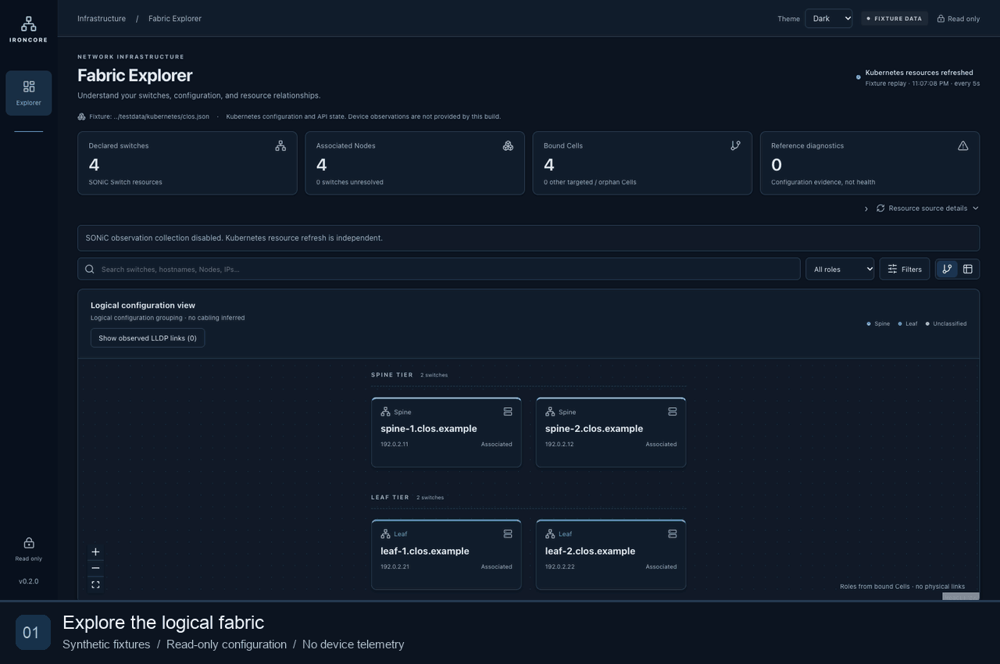

# IronCore Fabric Explorer

A read-only dashboard for SONiC provisioning declarations and IronCore Fabric configuration. Go serves a React/TypeScript application with searchable inventory, a deterministic Clos layout, and switch/Cell/interface inspection.

**Try it without a cluster:** the default mode uses a fully synthetic two-spine/two-leaf fixture. The optional integration reads existing Kubernetes APIs from an explicitly selected [IronCore in a Box](https://github.com/ironcore-dev/ironcore-in-a-box) environment. There is one application backend, no external database, and no switch-side service to install.

*An interactive tour using synthetic fixtures only. Click the animation for a [static screenshot](docs/images/fabric-explorer-overview.png).*

## Quick start

Prerequisites: Go 1.25+, Node.js 22.12+ (or Node.js 24), npm.

~~~sh
npm --prefix web ci
npm --prefix web run build
go build -trimpath -o bin/fabric-explorer ./cmd/fabric-explorer
./bin/fabric-explorer --mode fixture --listen 127.0.0.1:8102
~~~

Open http://127.0.0.1:8102. The **FIXTURE DATA** indicator distinguishes synthetic examples from actual Kubernetes inventory. Fixture status values are examples, not observations from equipment.

~~~sh
# Alternative: single-container demo
 docker build -t fabric-explorer:local .
 docker run --rm --read-only --cap-drop ALL --security-opt no-new-privileges \
   -p 127.0.0.1:8102:8080 fabric-explorer:local
# Or: docker compose up --build
~~~

## Features

- Search/filter every Switch, including unassociated and unclassified resources.
- Logical spine/leaf grouping, zoom/pan, shared selection and URL state.
- Inspect Node association evidence, valid bound Cells and other targeted Cells.
- Inspect ordered Cell prefixes, local fabric/south-facing peers and Interface references.
- Separate desired interface state from Kubernetes API-reported state.
- Explain missing references, conflicting owners, ambiguous mappings and stale/partial sources.
- System/Light/Dark theme with persisted preference and system-change support.

The graph is a logical configuration view. Local Cell interfaces do not establish remote cabling. No physical links, BGP sessions, device port health or traffic counters are fabricated. Operational-view components and a versioned model are reserved for future observation integration; this distribution supplies no switch connector. GET /api/v1/observations reports disabled with empty data.

## IronCore in a Box integration

Follow [the integration guide](docs/ironcore-in-a-box.md). The upstream environment does not necessarily install SONiC Operator/Fabric CRDs or supply fabric objects. Missing APIs and empty inventory are valid states, not successful fabric discovery. The helper only checks existing CRDs and starts read-only access; it installs nothing.

~~~sh
# Select your existing local environment explicitly; credentials stay outside the repo.
./scripts/run-in-a-box.sh /path/to/local-reader.kubeconfig your-explicit-context
~~~

Direct API mode uses only Switch, Fabric Node, Interface and Cell resources. SwitchInterface and Secrets are not read. The provided [deployment manifest](deploy/deployment.yaml) grants only get/list/watch and runs non-root with a read-only filesystem. Deployment is optional and must be explicitly performed in your own environment. This application does not apply resources.

## Configuration

| Option | Behavior |
|---|---|
| --mode fixture | Default; no Kubernetes credentials or equipment access |
| --fixture path | Synthetic fixture file; reread on polling for local stale/recovery demos |
| --mode live | Direct Kubernetes API reads; requires explicit --kubeconfig and --context, or --in-cluster |
| --listen | Default 127.0.0.1:8080; quick-start uses 8102 |
| --poll-interval | Default 5s, supported 1s–5m; no overlapping polls |
| --poll-timeout | Default 4s, supported 1s–1m per source |
| --cell-namespaces | Optional comma-separated namespace restriction; Switch inventory remains cluster-scoped |
| --mapping path | Optional JSON Switch-name → Node-name map, with explicit association evidence |
| --fabriclet-container | Recognized provisioning declaration container name; default fabriclet |

Kubernetes Ready means provisioning declaration acceptance, not proven device reachability. Cell Active is not BGP convergence. LIST timestamps are resource refresh times, not switch observation times. The backend keeps last-known results after failed refreshes and reports source completeness/errors.

## Development and checks

~~~sh
make test
make build
# Separate hot-reload frontend (proxies API requests to localhost:8080)
./bin/fabric-explorer --listen 127.0.0.1:8080
npm --prefix web run dev

# Short fixture-only browser test, with isolated Chromium profile
cd web && npx playwright install chromium && npm run test:e2e
cd ..
~~~

See [development](docs/development.md), [demo capture](docs/readme-demo.md), [validation](docs/validation-results.md), and [release preparation](docs/release-readiness.md). No external equipment or cluster is required for tests. Synthetic failure fixtures cover unresolved Nodes/Interfaces, ambiguous claims, mismatched Cell UIDs, multiple targeted Cells, unknown roles and incomplete sources.

## Security and licensing

The HTTP service allows GET/HEAD only and exposes allowlisted DTOs. It has no command-execution or configuration-change endpoints. Bind to loopback for development; use an authenticated ingress/security boundary if you deploy it for others. Keep credentials and real environment captures outside this repository and build context. See [SECURITY.md](SECURITY.md).

Apache-2.0; see [LICENSE](LICENSE).
